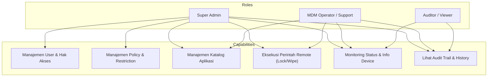
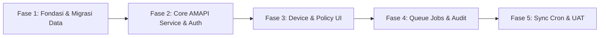

# Product Requirements Document (PRD)

## MDM Dashboard Modernization & Migration (Laravel + Android Management API)

- **Document Version:** 1.0.0
- **Document Status:** Approved for Design & Architecture
- **Target Tech Stack:** Laravel 11.x, Inertia React.js, PHP 8.2+, MySQL 8.0, Google Android Management API (AMAPI)
- **Author:** Senior Software Engineer

---

## 1. Executive Summary & Problem Statement

### 1.1 Executive Summary

Proyek ini bertujuan untuk memodernisasi dan memigrasikan platform **Mobile Device Management (MDM)** berbasis **Google Android Management API (AMAPI)** dari sistem PHP kustom (legacy/native) ke framework **Laravel 11**.

Modernisasi ini akan mentransformasikan dashboard operasional yang sebelumnya lambat, rentan keamanan, dan tidak memiliki persistensi data lokal, menjadi sistem enterprise-grade yang tangguh, aman, memiliki audit log lengkap, serta mampu mengelola ribuan perangkat secara real-time dan asinkron.

### 1.2 Problem Statement

Sistem lama memiliki sejumlah kendala mendasar:

1. **Performa Lambat & Ketergantungan API Penuh:** Tidak adanya database lokal untuk perangkat menyebabkan setiap request halaman memicu panggilan sinkron ke Google API secara berulang (_blocking I/O_), menghabiskan kuota rate limit Google dan menyebabkan halaman lambat (3-10 detik).
2. **Risiko Keamanan Kritis:** Kredensial database dan _Google Service Account private keys_ tersimpan secara _hardcoded_ di repository; tidak ada perlindungan CSRF pada aksi berbahaya (_Lock, Reboot, Reset PIN, Unenroll_).
3. **Ketiadaan Audit Trail:** Tidak ada pencatatan (_history_) siapa operator yang mengirimkan perintah kendali jarak jauh pada perangkat, kapan perintah dijalankan, dan apa hasilnya.
4. **Data Disjoint & Rapuh:** Informasi pemilik/anggota (`pemilik`) terpisah dan dihubungkan secara manual dengan nama perangkat AMAPI di level tampilan (_view_), tanpa integritas relasional database (_foreign keys_).

---

## 2. Product Objectives & Success Metrics

### 2.1 Tujuan Produk

- **Reliabilitas Pengelolaan Armada (_Fleet Management_):** Menjamin pemantauan status perangkat, kepatuhan (_compliance_), dan ketersediaan perangkat secara akurat dan cepat.
- **Keamanan Operasional & Tata Kelola:** Memastikan akses berbasis peran (_Role-Based Access Control_), tokenisasi CSRF, enkripsi kredensial, dan pencatatan audit 100% pada perintah kritis.
- **Responsivitas Perintah Jarak Jauh (_Remote Actions_):** Mengeksekusi perintah perangkat (_Lock, Lost Mode, Reset Passcode, Kiosk Mode, Reboot_) secara asinkron (_background queue_) sehingga UI admin merespons instan (< 300ms).
- **Distribusi Aplikasi Terkendali:** Mempermudah pencarian aplikasi Play Store, instalasi massal, dan penetapan aplikasi _kiosk_ untuk operasional lapangan.

### 2.2 Success Metrics (KPIs)

| Metrik                                   | Baseline (Sistem Lama) | Target (Laravel Baru)                 |
| :--------------------------------------- | :--------------------- | :------------------------------------ |
| **Waktu Muat Halaman Daftar Perangkat**  | 2.500 ms – 6.000 ms    | < 200 ms (dari sinkronisasi DB lokal) |
| **Respon UI saat Eksekusi Perintah**     | 1.500 ms – 4.000 ms    | < 250 ms (dijadwalkan via Queue)      |
| **Audit Logging Coverage**               | 0%                     | 100% perintah remote & mutasi data    |
| **Keamanan Kredensial**                  | Terpapar di repo Git   | 0% hardcoded, terisolasi via `.env`   |
| **Integritas Data Pemilik vs Perangkat** | String matching lepas  | Foreign key terindeks di database     |

---

## 3. User Personas & Role-Based Access Control (RBAC)

### 3.1 Deskripsi Peran Pengguna

1. **Super Admin:** Memiliki kontrol penuh atas platform, konfigurasi enterprise AMAPI, manajemen akun pengguna, modifikasi policy tingkat enterprise, dan semua perintah perangkat.
2. **MDM Operator / Field Support:** Petugas harian yang memonitor perangkat agen/anggota, mendaftarkan (_enroll_) perangkat baru, menautkan pemilik perangkat, serta menjalankan tindakan insidental seperti _Lost Mode_, _Lock_, atau _Reset PIN_.
3. **Auditor / Management Viewer:** Akses _read-only_ untuk melihat metrik operasional, persebaran perangkat, status kepatuhan, serta log aktivitas perintah.

---

## 4. Functional Requirements (FR)

### Modul 1: Autentikasi & Akun Pengguna

- **FR-1.1:** Sistem harus menyediakan autentikasi berbasis sesi yang aman dengan perlindungan terhadap _brute force_ (rate limiting).
- **FR-1.2:** Sistem harus membatasi aksi berdasarkan role (`admin`, `operator`, `auditor`) menggunakan Laravel Policy & Middleware.
- **FR-1.3:** Super Admin dapat menambah, mengedit, menonaktifkan, dan menghapus akun pengguna lain.

### Modul 2: Manajemen Perangkat & Armada (Device Fleet)

- **FR-2.1:** Sistem harus menyimpan cache data seluruh perangkat yang terdaftar di Google AMAPI ke dalam database lokal.
- **FR-2.2:** Menampilkan daftar perangkat lengkap dengan filter: Model/Merk, Status (_Active, Disabled, Lost Mode_), Status Kepatuhan (_Compliant / Non-Compliant_), dan Pemilik.
- **FR-2.3:** Menampilkan detail spesifik perangkat: IMEI, Nomor Seri, Level Baterai, Penyimpanan, Versi Android, Patch Keamanan, dan Aplikasi yang terpasang.
- **FR-2.4:** Menyediakan tombol pemutakhiran paksa (_Force Sync_) untuk menarik data terbaru perangkat dari Google Cloud.
- **FR-2.5:** Mendukung aksi _Unenroll / Wipe Device_ dengan konfirmasi ganda (_double confirmation modal_).

### Modul 3: Manajemen Pemilik & Penugasan (Device Ownership)

- **FR-3.1:** Sistem memungkinkan penautan perangkat dengan identitas pemilik (Nama, ID Anggota/Agen, Nomor Telepon, Departemen/Wilayah).
- **FR-3.2:** Riwayat kepemilikan harus tercatat jika sebuah perangkat berpindah tangan dari satu agen ke agen lain.
- **FR-3.3:** Pencarian perangkat dapat dilakukan berdasarkan Nama Pemilik atau ID Anggota secara instan.

### Modul 4: Remote Command & Incident Management

- **FR-4.1:** **Lock Device:** Mengunci layar perangkat secara remote seketika.
- **FR-4.2:** **Reset PIN/Password:** Mengubah atau mereset PIN keamanan perangkat dengan opsi _Lock Now_ dan _Require Entry_.
- **FR-4.3:** **Reboot Device:** Memerintahkan restart perangkat secara remote.
- **FR-4.4:** **Lost Mode (Mode Hilang):** Mengaktifkan mode hilang dengan menampilkan pesan khusus di layar (misal: _"Perangkat ini milik operasional, hubungi Admin"_) serta nomor telepon darurat yang dapat ditelepon langsung dari layar terkunci.
- **FR-4.5:** **Stop Lost Mode (Unlock):** Membuka kembali status _Lost Mode_ saat perangkat telah ditemukan.
- **FR-4.6:** Semua perintah harus dimasukkan ke dalam antrean asinkron (_Queue_) dan mencatat ID request AMAPI ke tabel audit.

### Modul 5: Manajemen Policy & Kepatuhan

- **FR-5.1:** Menampilkan daftar policy enterprise yang ada di Google AMAPI.
- **FR-5.2:** Membuat policy baru dengan pengaturan proteksi terpadu:
  - Nonaktifkan Kamera (`cameraDisabled`).
  - Kunci Konfigurasi Wi-Fi (`wifiConfigDisabled`).
  - Cegah Factory Reset mandiri (`factoryResetDisabled`).
  - Cegah instalasi aplikasi pihak ketiga di luar katalog (`installAppsDisabled`).
  - Nonaktifkan Safe Boot (`safeBootDisabled`).
  - Paksa GPS / Lokasi Akurasi Tinggi (`locationMode: HIGH_ACCURACY`).
- **FR-5.3:** Konfigurasi _Kiosk Mode_ (mengunci perangkat hanya untuk membuka satu aplikasi atau halaman tertentu, misal: portal tagihan/kiosk).
- **FR-5.4:** Mengubah policy perangkat tertentu (_Switch Policy_) secara langsung dari halaman detail perangkat.

### Modul 6: Manajemen Katalog Aplikasi & Google Play

- **FR-6.1:** Pencarian aplikasi publik dari Google Play Store menggunakan kata kunci, menampilkan nama aplikasi, package name, icon, dan developer.
- **FR-6.2:** Menyimpan aplikasi terpilih ke dalam database katalog aplikasi lokal (`apps`).
- **FR-6.3:** Menambahkan aplikasi dari katalog ke dalam policy tertentu dengan konfigurasi mode instalasi:
  - `FORCE_INSTALLED`: Aplikasi terpasang otomatis tanpa interaksi user dan tidak dapat di-uninstall.
  - `AVAILABLE`: Tersedia di Google Play Managed untuk diinstal jika dibutuhkan.
  - `KIOSK`: Dijadikan aplikasi utama antarmuka perangkat terkunci.

### Modul 7: Enrollment & Onboarding Perangkat

- **FR-7.1:** Pembuatan _Enrollment Token_ baru dengan memilih policy awal yang akan diterapkan.
- **FR-7.2:** Mengatur masa berlaku token (default 7 hari / kustom).
- **FR-7.3:** Generate QR Code interaktif secara real-time yang dapat langsung di-scan oleh perangkat Android baru (factory state) dengan mengetuk layar 6 kali.
- **FR-7.4:** Tampilan cetak (_printable view_) untuk lembar QR Code pendaftaran perangkat di lapangan.

### Modul 8: Audit Logging & Monitoring Real-Time

- **FR-8.1:** Mencatat setiap aktivitas krusial ke tabel `audit_logs`:
  - Siapa (_User ID & Username_).
  - Aksi (_LOCK_DEVICE, RESET_PIN, UNENROLL, UPDATE_POLICY_).
  - Target (_Device Name / ID & Nama Pemilik_).
  - Waktu eksekusi, IP Address, dan status respon AMAPI.
- **FR-8.2:** Dashboard utama menampilkan indikator kesehatan armada: Total Perangkat Aktif, Perangkat Pending Enrollment, Perangkat Non-Compliant, dan Policy Aktif.

---

## 5. Non-Functional Requirements (NFR)

| Kategori           | Spesifikasi & Standar                                                                                                                                                                                                                                                                                                                |
| :----------------- | :----------------------------------------------------------------------------------------------------------------------------------------------------------------------------------------------------------------------------------------------------------------------------------------------------------------------------------- |
| **Keamanan**       | • Proteksi CSRF pada 100% form POST/PUT/DELETE. • Password hashing menggunakan Bcrypt (cost factor default Laravel 12). • Zero secret commit: kredensial diatur via file `.env`. • Google Service Account disimpan di luar direktori web root (`storage/app/credentials`). • Rate limiting login: 5 percobaan per menit. |
| **Performa**       | • Waktu respon API/Halaman baca < 200 ms. • Eksekusi dispatch command < 50 ms (dilempar ke Background Job). • Database queries dioptimasi dengan indexing pada kolom pencarian (`device_name`, `serial_number`, `id_anggota`).                                                                                                 |
| **Reliabilitas**   | • Auto-retry pada queue worker (maksimal 3 kali percobaan dengan exponential backoff jika Google API merespon 503/429). • Graceful degradation jika Google API down (dashboard tetap menampilkan cache data lokal terakhir).                                                                                                      |
| **Kompatibilitas** | • Web responsive (Bootstrap 5 / TailwindCSS) mendukung desktop browser (Chrome, Edge, Firefox, Safari) dan tablet admin lapangan. • Kompatibel dengan Android 9.0 (Pie) hingga Android 14+ untuk pengelolaan AMAPI.                                                                                                               |

---

## 6. Out of Scope (Tahap 1 / Non-Prioritas Saat Ini)

- Multi-enterprise tenancy (sistem dirancang untuk mengelola satu Enterprise ID organisasi saat ini).
- Custom APK private storage (hosting file APK sendiri di S3; aplikasi diprioritaskan bersumber dari Google Play Store resmi atau Google Play Custom Apps).
- Push Notification FCM langsung ke aplikasi custom di luar ekosistem AMAPI.

---

## 7. Phased Release Milestones

1. **Milestone 1 (Fondasi):** Inisialisasi Laravel 11, setup database migrations, transfer data eksisting dari database lama (`pemilik`, `users`, `apps`), implementasi keamanan `.env`.
2. **Milestone 2 (Core Service):** Pembentukan `AndroidManagementService`, integrasi Service Account, penyiapan Google Play Scraper dan QR Generator.
3. **Milestone 3 (Web UI & RBAC):** Implementasi modul Dashboard, List & Detail Device, Form Policy, Google Play Catalog, dan Enrollment QR.
4. **Milestone 4 (Asynchronous & Audit):** Setup Laravel Queue (Database/Redis driver), migrasi aksi command remote ke Background Jobs, dan integrasi Audit Trail logging.
5. **Milestone 5 (Sinkronisasi & Rilis):** Implementasi scheduled sync command (`php artisan mdm:sync-devices`), UAT, dan peralihan produksi (_cutover_).
