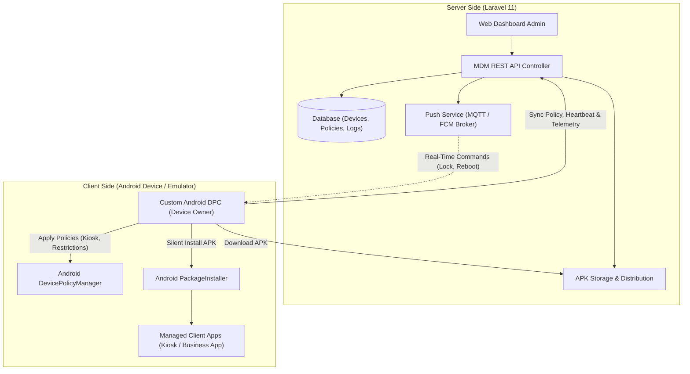

# PRD: Independent Android Mobile Device Management (In-House MDM)

**Versi Dokumen:** 1.0.0  
**Status:** Draf Perencanaan  
**Target Platform:** Laravel 11 (Backend & Dashboard) + Native Android DPC (Client Agent)  
**Tujuan:** Menggantikan ketergantungan pada Google Android Management API (AMAPI) dengan infrastruktur MDM mandiri (*self-hosted*).

---

## 1. Latar Belakang & Tujuan (Objective)

### 1.1 Masalah
Saat ini sistem bergantung penuh pada Google Android Management API (AMAPI). Hal ini menimbulkan kendala:
* Ketergantungan pada ekosistem *cloud* Google dan kuota/kebijakan API eksternal.
* Tidak dapat berjalan di jaringan lokal (*intranet/on-premise*) tanpa akses internet publik.
* Tidak mendukung perangkat Android Non-GMS (tanpa Google Play Services) seperti perangkat kasir POS kustom atau tablet industri.

### 1.2 Tujuan
Membangun solusi MDM mandiri *end-to-end* yang terdiri dari:
1. **Custom Android DPC (Device Policy Controller)** yang berjalan sebagai *Device Owner* (DO).
2. **Backend Engine & API** di atas framework Laravel 11 untuk mengatur kebijakan, inventaris perangkat, dan pengiriman perintah.
3. **Repository Distribusi APK Mandiri** untuk instalasi aplikasi tanpa melalui Google Play Store.

---

## 2. Ruang Lingkup (Scope)

```
┌────────────────────────────────────────────────────────┐
│                      RUANG LINGKUP                     │
├───────────────────────────┬────────────────────────────┤
│ Di Dalam Lingkup (In-Scope)│ Di Luar Lingkup (Phase 1) │
├───────────────────────────┼────────────────────────────┤
│ • Custom DPC (Android)    │ • Managed Google Play      │
│ • QR & ADB Provisioning   │ • Apple iOS Support        │
│ • Kiosk Mode (LockTask)   │ • Zero-Touch Portal OEM    │
│ • Silent APK Install/Update│ • Knox Mobile Enrollment   │
│ • Remote Lock, Wipe, Reboot│                            │
│ • Heartbeat & Telemetry   │                            │
│ • Testing via Emulator    │                            │
└───────────────────────────┴────────────────────────────┘
```

---

## 3. Arsitektur Sistem



---

## 4. Kebutuhan Fungsional (Functional Requirements)

### Modul 1: Enrollment & Provisioning
* **FR-1.1**: Dashboard mampu men-generate konfigurasi provisioning dalam bentuk QR Code standar Android Enterprise.
* **FR-1.2**: Payload QR Code menyertakan URL download DPC, *checksum* SHA-256 APK, komponen admin, serta token unik perangkat.
* **FR-1.3**: DPC dapat di-enroll menggunakan perintah ADB (mode *developer/emulator*) tanpa perlu *factory reset*.
* **FR-1.4**: Autentikasi perangkat ke backend menggunakan token unik (*Device API Token / HMAC*).

### Modul 2: Device Inventory & Telemetry
* **FR-2.1**: DPC mengirimkan sinyal *Heartbeat* berkala (misal tiap 5-15 menit) berisi:
  * Status baterai & pengisian daya.
  * Status memori & sisa penyimpanan (*storage*).
  * Alamat IP lokal, Wi-Fi SSID, dan kekuatan sinyal.
  * Versi OS Android dan level patch keamanan.
  * Daftar paket aplikasi yang terpasang (*installed packages*).
* **FR-2.2**: Dashboard menampilkan status perangkat secara *real-time* (Online / Offline / Inactive).

### Modul 3: Policy Enforcement (Kebijakan Perangkat)
* **FR-3.1 Kiosk Mode (LockTaskMode)**: DPC dapat mengunci layar pada satu aplikasi tertentu (atau *multi-app kiosk*) dan menonaktifkan tombol *Home*, *Recent Apps*, serta panel notifikasi (*Status Bar*).
* **FR-3.2 Pembatasan Pengguna (User Restrictions)**:
  * Larangan *Factory Reset* manual oleh pengguna.
  * Larangan mengubah pengaturan Wi-Fi / Bluetooth.
  * Larangan instalasi aplikasi dari sumber tak dikenal (hanya via DPC).
  * Larangan transfer data via USB (*MTP transfer*).
  * Menonaktifkan kamera atau *screenshot*.

### Modul 4: Manajemen Aplikasi Mandiri (Private App Distribution)
* **FR-4.1**: Admin dapat mengunggah file `.apk` ke dashboard Laravel.
* **FR-4.2**: Sistem mencatat `packageName`, `versionCode`, dan menghitung hash SHA-256 secara otomatis.
* **FR-4.3 Silent Installation**: DPC mengunduh file APK dan melakukan instalasi tanpa memunculkan dialog persetujuan ke layar pengguna menggunakan Android [`PackageInstaller`](https://developer.android.com/reference/android/content/pm/PackageInstaller) API.
* **FR-4.4 Silent Update & Uninstall**: DPC dapat memperbarui atau menghapus paket aplikasi secara otomatis sesuai instruksi kebijakan.

### Modul 5: Remote Actions (Perintah Jarak Jauh)
* **FR-5.1**: Remote Lock (mengunci layar seketika dengan PIN darurat).
* **FR-5.2**: Remote Reboot (memulai ulang perangkat).
* **FR-5.3**: Remote Wipe / Factory Reset (menghapus seluruh data perangkat bila hilang atau dicuri).
* **FR-5.4**: Remote Clear Data / Cache aplikasi tertentu.

---

## 5. Strategi Pengujian Menggunakan Android Emulator

> [!IMPORTANT]
> **Tidak Diperlukan Perangkat Fisik yang Direset.**
> Pengujian DPC (Device Owner) 100% dapat dilakukan pada Android Studio Virtual Device (AVD).

### Alur Pengujian di Emulator:
1. **Pembuatan AVD Bersih**:
   * Buat emulator baru di Android Studio (disarankan Android 11 / API 30 hingga Android 14 / API 34).
   * Pilih sistem image **Google APIs** atau **AOSP (tanpa Google APIs)** untuk menguji skenario offline.
2. **Aktivasi Device Owner via ADB (Tanpa Factory Reset)**:
   * Instal DPC APK ke emulator:
     ```bash
     adb install app-debug.apk
     ```
   * Aktifkan status Device Owner secara instan:
     ```bash
     adb shell dpm set-device-owner com.yourcompany.dpc/.receivers.MdmAdminReceiver
     ```
3. **Simulasi Factory Reset**:
   * Jika ingin menguji dari kondisi nol, cukup klik kanan AVD di Android Studio -> **"Wipe Data"** (selesai dalam 5 detik).

---

## 6. Tahapan & Jadwal Implementasi (Milestones)

| Milestone | Fase | Deliverable Utama | Estimasi Fokus |
| :--- | :--- | :--- | :--- |
| **M1** | Fondasi Backend & Skema Data | Database Migration, Model Device, Policy & Enrollment Token API di Laravel | 2-3 Hari |
| **M2** | Core Custom DPC Android | Project Android, `DeviceAdminReceiver`, Set Device Owner via ADB, Tes Kiosk & Lock | 3-4 Hari |
| **M3** | Jalur Sinkronisasi & Telemetry | DPC mengirim heartbeat, sinkronisasi kebijakan JSON dari Laravel | 2-3 Hari |
| **M4** | Silent APK Installer | Integrasi `PackageInstaller` di DPC, upload APK di dashboard, auto-install | 3-4 Hari |
| **M5** | Real-Time Push Commands | Implementasi MQTT/FCM data message untuk Lock, Wipe, Reboot instan | 2-3 Hari |
| **M6** | UI Dashboard & Stabilisasi | Halaman manajemen perangkat, monitoring status, dan pengujian menyeluruh di Emulator | 3-4 Hari |

---

## 7. Pertimbangan Keamanan & Keandalan

* **Anti-Tampering**: Aplikasi DPC tidak dapat di-*uninstall* atau di-*force stop* oleh siapapun di perangkat setelah berstatus *Device Owner*.
* **Toleransi Offline**: Jika koneksi jaringan terputus, DPC harus tetap mempertahankan kebijakan terakhir yang tersimpan di lokal (*SQLite / DataStore*).
* **Integritas File APK**: Verifikasi hash SHA-256 file APK sebelum instalasi dijalankan untuk mencegah *man-in-the-middle attack*.
