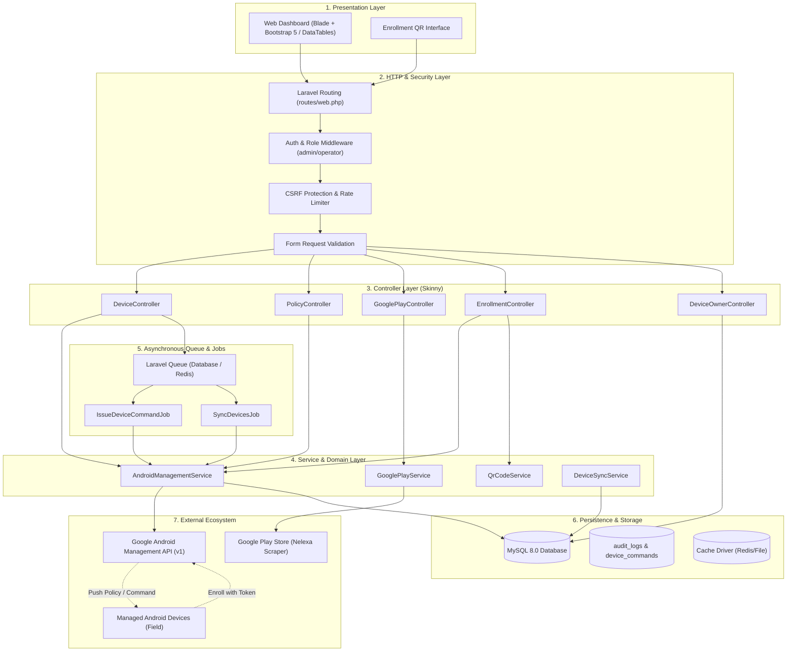
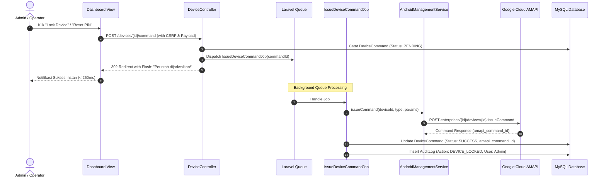
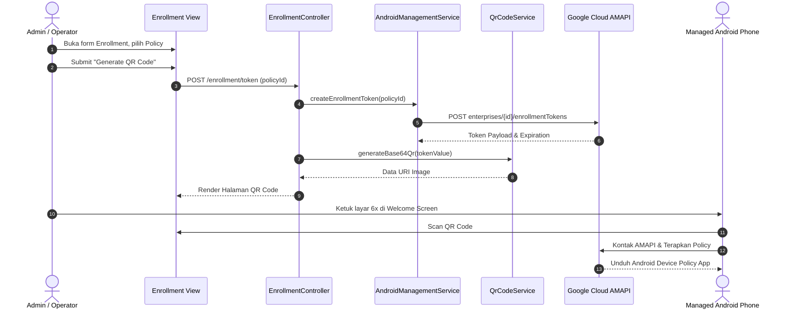
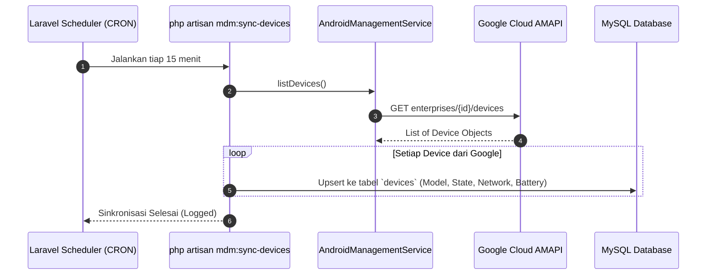
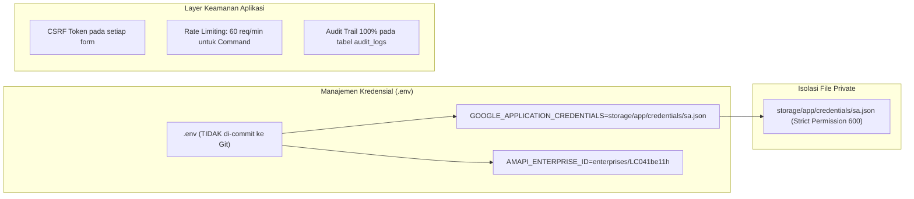
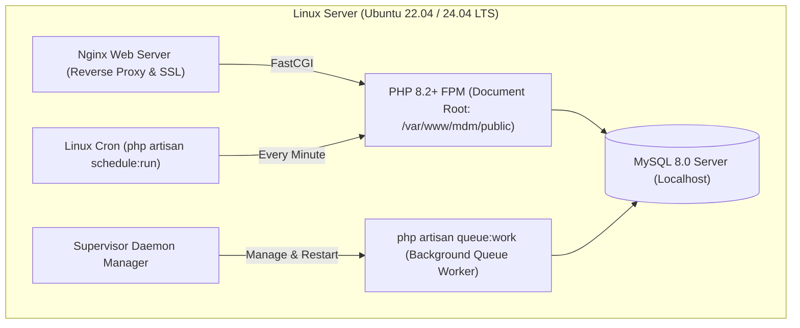

# System Design Document (SDD)
## MDM Dashboard Architecture & Laravel Migration Blueprint

- **Document Version:** 1.0.0
- **Status:** Approved for Implementation
- **Tech Stack:** Laravel 11.x, PHP 8.2+, MySQL 8.0 / MariaDB 10.6, Google Cloud AMAPI (v1)
- **Author:** Senior Software Engineer

---

## 1. High-Level System Architecture

Sistem MDM Dashboard dirancang menggunakan pendekatan **Clean Layered Architecture (Multi-Tier)** dengan pemisahan tegas antara antarmuka (Presentation), logika aplikasi (HTTP/Controllers), logika bisnis inti (Domain/Service Layer), penyimpanan persisten (Database/Eloquent), dan integrasi pihak ketiga (Google Cloud Platform).



---

## 2. Technology Stack & Libraries

| Komponen | Pilihan Teknologi | Alasan & Manfaat Teknis |
| :--- | :--- | :--- |
| **Framework Utama** | **Laravel 11.x** (PHP 8.2+) | Standar industri, Dependency Injection kelas satu, ekosistem keamanan matang, Eloquent ORM. |
| **Database** | **MySQL 8.0 / MariaDB 10.6+** | Relasional ACID, performa tinggi dengan indexing JSON data (untuk menyimpan payload AMAPI). |
| **Queue & Worker** | **Laravel Queue (Database / Redis)** | Mengubah eksekusi perintah sinkron yang lambat menjadi proses asinkron instan. |
| **Google API Client** | `google/apiclient: ^2.18` | Library resmi Google untuk otentikasi Service Account OAuth2 dan interaksi AMAPI. |
| **QR Code Engine** | `endroid/qr-code: ^5.0` | Pembuatan QR enrollment token langsung dalam bentuk Base64 Data URI untuk tag ``. |
| **Play Store Engine** | `nelexa/google-play-scraper: ^0.5` | Scraping metadata aplikasi Android resmi (ikon, package name, judul). |
| **Frontend Framework** | **Blade + Bootstrap 5 + DataTables** | Ringan, kompatibel dengan layout aset lama, cepat diimplementasikan tanpa overhead SPA build kompleks. |

---

## 3. Database Architecture & ERD

Database dirancang untuk menjadi **Single Source of Truth** lokal agar performa dashboard tidak lagi bergantung pada panggilan HTTP berulang ke Google Cloud.

```mermaid
erDiagram
    users ||--o{ audit_logs : "creates"
    users ||--o{ device_commands : "issues"
    policies ||--o{ devices : "applies_to"
    policies ||--o{ policy_applications : "contains"
    apps ||--o{ policy_applications : "assigned_in"
    devices ||--o| device_owners : "assigned_to"
    devices ||--o{ device_commands : "receives"

    users {
        bigint id PK
        string username UK
        string name
        string email
        string password
        enum role "admin, operator, auditor"
        timestamp created_at
    }

    devices {
        bigint id PK
        string device_id UK "Resource name AMAPI"
        string hardware_model
        string brand
        string manufacturer
        string serial_number
        string android_version
        string state "ACTIVE, PROVISIONING, DISABLED"
        string policy_id FK
        json network_info
        json memory_info
        timestamp last_status_report
        timestamp enrolled_at
        timestamp updated_at
    }

    device_owners {
        bigint id PK
        bigint device_id FK UK
        string nama
        string id_anggota "Unique member ID"
        string telepon
        string departemen
        text catatan
        timestamp created_at
    }

    policies {
        bigint id PK
        string policy_id UK "AMAPI identifier (e.g. default, kiosk)"
        string name "Display name"
        text description
        boolean camera_disabled
        boolean wifi_config_disabled
        boolean factory_reset_disabled
        boolean install_apps_disabled
        boolean safe_boot_disabled
        string location_mode
        json raw_policy_json
        timestamp updated_at
    }

    apps {
        bigint id PK
        string package_name UK
        string app_name
        string icon_url
        string developer
        timestamp created_at
    }

    policy_applications {
        bigint id PK
        bigint policy_id FK
        bigint app_id FK
        enum install_type "FORCE_INSTALLED, AVAILABLE, KIOSK"
        boolean auto_update
    }

    device_commands {
        bigint id PK
        bigint device_id FK
        bigint issued_by_user_id FK
        string command_type "LOCK, REBOOT, RESET_PASSWORD, START_LOST_MODE, STOP_LOST_MODE"
        json command_params
        enum status "PENDING, SUCCESS, FAILED"
        string amapi_command_id
        text error_message
        timestamp executed_at
    }

    audit_logs {
        bigint id PK
        bigint user_id FK
        string action
        string target_type
        string target_id
        json old_values
        json new_values
        string ip_address
        string user_agent
        timestamp created_at
    }
```

---

## 4. Class Design & Service Layer Pattern

Semua interaksi pihak ketiga diisolasi ke dalam **Services** dengan prinsip *Single Responsibility Principle* (SRP) dan *Dependency Injection*.

### 4.1 `AndroidManagementService`
Bertanggung jawab menangani seluruh komunikasi ke Google Android Management API via `Google\Client`.

```php
namespace App\Services;

use Google\Client;
use Google\Service\AndroidManagement;
use Google\Service\AndroidManagement\Command;
use Google\Service\AndroidManagement\Policy;
use Google\Service\AndroidManagement\EnrollmentToken;

class AndroidManagementService
{
    protected AndroidManagement $service;
    protected string $enterpriseId;

    public function __construct()
    {
        $client = new Client();
        $client->setAuthConfig(config('amapi.credentials_path'));
        $client->addScope(AndroidManagement::ANDROIDMANAGEMENT);

        $this->service = new AndroidManagement($client);
        $this->enterpriseId = config('amapi.enterprise_id');
    }

    // Devices
    public function listDevices(int $pageSize = 100, ?string $pageToken = null);
    public function getDevice(string $deviceId);
    public function unenrollDevice(string $deviceId): bool;
    public function patchDevicePolicy(string $deviceId, string $policyId);

    // Commands
    public function issueCommand(string $deviceId, string $type, array $params = []): Command;

    // Policies
    public function listPolicies();
    public function getPolicy(string $policyId): Policy;
    public function patchPolicy(string $policyId, array $policyData): Policy;
    public function deletePolicy(string $policyId): bool;

    // Enrollment
    public function createEnrollmentToken(string $policyId, int $durationSeconds = 604800): EnrollmentToken;
}
```

### 4.2 `GooglePlayService`
Bertanggung jawab melakukan scraping data aplikasi dari Play Store dan melakukan fuzzy sorting berdasarkan relevansi pencarian.

```php
namespace App\Services;

use Nelexa\GPlay\GPlayApps;
use Illuminate\Support\Facades\Cache;

class GooglePlayService
{
    protected GPlayApps $gplay;

    public function __construct()
    {
        $this->gplay = new GPlayApps();
    }

    public function search(string $keyword, int $limit = 30): array
    {
        $cacheKey = 'gplay_search_' . md5(strtolower($keyword));

        return Cache::remember($cacheKey, now()->addHours(6), function () use ($keyword, $limit) {
            $results = $this->gplay->search($keyword, 100);
            $apps = [];
            foreach ($results as $app) {
                if ($app) {
                    $apps[] = [
                        'app_name'     => $app->getName() ?? 'Unknown',
                        'package_name' => $app->getId() ?? '',
                        'icon'         => $app->getIcon() ? $app->getIcon()->getUrl() : null,
                        'developer'    => $app->getDeveloper() ? $app->getDeveloper()->getName() : 'Unknown',
                    ];
                }
            }
            return array_slice($apps, 0, $limit);
        });
    }
}
```

### 4.3 `QrCodeService`
Menghasilkan QR code token pendaftaran perangkat dalam format Base64 Data URI untuk ditampilkan di peramban.

```php
namespace App\Services;

use Endroid\QrCode\Builder\Builder;
use Endroid\QrCode\Writer\PngWriter;

class QrCodeService
{
    public function generateBase64Qr(string $payload): string
    {
        $result = Builder::create()
            ->writer(new PngWriter())
            ->data($payload)
            ->size(280)
            ->margin(12)
            ->build();

        return $result->getDataUri();
    }
}
```

---

## 5. Sequence Diagrams

### 5.1 Remote Command Execution (Lock / Reset PIN / Reboot)
Memastikan eksekusi perintah berlangsung asinkron sehingga pengguna tidak mengalami *browser hanging*.



### 5.2 Device Enrollment Flow
Alur pendaftaran perangkat baru dari pabrik (*Out of the Box*) menggunakan token QR.



### 5.3 Scheduled Device Fleet Synchronization
Menjaga keselarasan data armada antara Google Cloud dan database lokal secara otomatis.



---

## 6. Route Specifications (Laravel Route Map)

### 6.1 Web Routes (`routes/web.php`)
Semua rute web dienkapsulasi dengan middleware `web` (Session, CSRF) dan `auth`.

| HTTP Method | URI | Controller & Action | Hak Akses | Keterangan |
| :--- | :--- | :--- | :--- | :--- |
| `GET` | `/dashboard` | `DashboardController@index` | Semua | Ringkasan metrik armada & statistik. |
| `GET` | `/devices` | `DeviceController@index` | Semua | Daftar perangkat (search, filter). |
| `GET` | `/devices/{device}` | `DeviceController@show` | Semua | Detail perangkat, status, hardware info. |
| `POST` | `/devices/{device}/command` | `DeviceController@issueCommand` | Admin, Operator | Kirim Lock, Reboot, Reset PIN, Lost Mode. |
| `POST` | `/devices/{device}/policy` | `DeviceController@updatePolicy` | Admin, Operator | Ubah policy aktif perangkat. |
| `DELETE`| `/devices/{device}/unenroll` | `DeviceController@unenroll` | Admin | Hapus dan reset perangkat secara remote. |
| `POST` | `/devices/sync` | `DeviceController@sync` | Admin, Operator | Trigger manual sinkronisasi dari Google. |
| `GET` | `/owners` | `DeviceOwnerController@index` | Semua | Daftar penugasan pemilik perangkat. |
| `POST` | `/owners` | `DeviceOwnerController@store` | Admin, Operator | Tautkan data pemilik ke perangkat. |
| `PUT` | `/owners/{id}` | `DeviceOwnerController@update` | Admin, Operator | Perbarui data pemilik/anggota. |
| `GET` | `/policies` | `PolicyController@index` | Semua | Daftar policy AMAPI. |
| `GET` | `/policies/create` | `PolicyController@create` | Admin | Tampilan form pembuat policy baru. |
| `POST` | `/policies` | `PolicyController@store` | Admin | Simpan & kirim policy baru ke AMAPI. |
| `GET` | `/policies/{id}/edit` | `PolicyController@edit` | Admin | Form edit konfigurasi policy. |
| `PUT` | `/policies/{id}` | `PolicyController@update` | Admin | Patch konfigurasi policy ke AMAPI. |
| `DELETE`| `/policies/{id}` | `PolicyController@destroy` | Admin | Hapus policy di Google AMAPI. |
| `GET` | `/apps` | `GooglePlayController@index` | Semua | Katalog aplikasi lokal. |
| `GET` | `/apps/search` | `GooglePlayController@search` | Admin, Operator | Cari aplikasi di Google Play Store. |
| `POST` | `/apps` | `GooglePlayController@store` | Admin | Simpan aplikasi ke database katalog. |
| `POST` | `/policies/{id}/apps` | `PolicyController@addApp` | Admin | Pasang aplikasi ke policy (*FORCE_INSTALLED*). |
| `GET` | `/enrollment` | `EnrollmentController@index` | Admin, Operator | Form pemilihan policy enrollment. |
| `POST` | `/enrollment/token` | `EnrollmentController@generate`| Admin, Operator | Buat token dan tampilkan QR code. |
| `GET` | `/audit-logs` | `AuditLogController@index` | Admin, Auditor | Riwayat log eksekusi dan aktivitas sistem. |
| `RESOURCE`| `/users` | `UserController` | Admin | Manajemen pengguna dashboard. |

---

## 7. Security & Secret Management



1. **Zero Secret Leakage:**
   - Hapus `ServiceAccount.json` dari folder publik/config repo.
   - Pindahkan ke `storage/app/credentials/google-service-account.json`.
   - Pastikan path ini terdaftar di `.gitignore` dan permissions diatur ke `chmod 600`.
2. **CSRF & Session Hijacking Protection:**
   - Semua formulir menggunakan `@csrf` Blade directive.
   - Session cookie diatur dengan flag `HttpOnly`, `SameSite=Lax`, dan `Secure` (di lingkungan HTTPS).
3. **Double Confirmation for High-Risk Actions:**
   - Perintah `Factory Reset / Unenroll` dan `Wipe` mewajibkan modal konfirmasi dengan pengetikan kata kunci (misal: `"CONFIRM"`) sebelum form dapat disubmit.

---

## 8. Deployment Architecture & Production Setup



### Rekomendasi Konfigurasi Supervisor (`/etc/supervisor/conf.d/mdm-worker.conf`):
```ini
[program:mdm-worker]
process_name=%(program_name)s_%(process_num)02d
command=php /var/www/mdm/artisan queue:work database --sleep=3 --tries=3 --max-time=3600
autostart=true
autorestart=true
stopasgroup=true
killasgroup=true
user=www-data
numprocs=2
redirect_stderr=true
stdout_logfile=/var/www/mdm/storage/logs/worker.log
stopwaitsecs=3600
```
