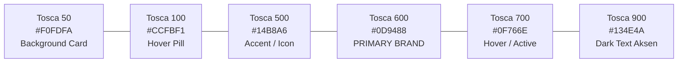
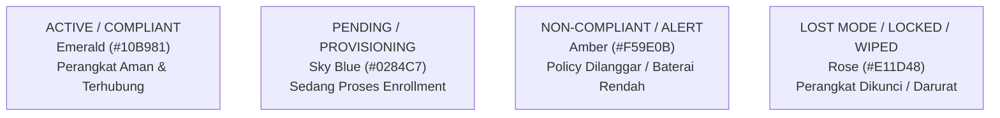

# UI Design System & Style Guide
## MDM Dashboard Modernization (Tosca Green Theme)

- **Document Type:** UI/UX Design System Specification (Design System & Style Guide)
- **Document Version:** 1.0.0
- **Status:** Approved for Frontend Implementation
- **Target Tech:** Bootstrap 5 / TailwindCSS, HTML5/CSS3, Blade Components
- **Primary Theme:** Enterprise Tosca Green (Modern Teal & Slate)

---

## 1. Pengenalan & Filosofi Desain

Dokumen ini disebut sebagai **UI Design System** (atau **UI/UX Style Guide**). Dokumen ini berfungsi sebagai acuan tunggal (*single source of truth*) bagi frontend developer dan desainer untuk memastikan seluruh tampilan dashboard konsisten, profesional, mudah dibaca (*high legibility*), dan ergonomis untuk penggunaan jangka panjang oleh tim operasional.

### Karakter Visual (Brand Persona)
- **Modern & Terpercaya (Trustworthy):** Menggunakan perpaduan **Hijau Tosca (Teal)** yang segar dan stabil, dipadukan dengan aksen **Slate/Navy** untuk mempertegas identitas *enterprise software*.
- **Informative & Scannable:** Data teknis perangkat (status baterai, kepatuhan, IMEI, model) harus dapat dipindai dengan cepat oleh mata tanpa menimbulkan kelelahan visual (*visual fatigue*).
- **Clear Visual Hierarchy:** Aksi berbahaya (seperti *Wipe, Reboot, Lost Mode*) memiliki diferensiasi visual yang tegas dibanding aksi navigasi harian.

---

## 2. Palet Warna (Color Palette & Design Tokens)

### 2.1 Warna Utama (Primary - Hijau Tosca / Teal)
Warna tosca menjadi identitas utama aplikasi, digunakan untuk tombol aksi utama, indikator aktif, aksen navigasi, dan elemen *brand*.



| Token Warna | Hex Code | Penggunaan di Dashboard |
| :--- | :--- | :--- |
| **`primary-50`** | `#F0FDFA` | Latar belakang badge aktif, hover state pada menu tosca lembut. |
| **`primary-100`** | `#CCFBF1` | Border halus pada card aktif, background info tosca. |
| **`primary-500`** | `#14B8A6` | Aksen grafis, toggle switch aktif, icon highlight. |
| **`primary-600`** | **`#0D9488`** | **Warna Utama (Primary Brand)**: Tombol utama, header tabel, icon sidebar aktif. |
| **`primary-700`** | `#0F766E` | Hover state tombol utama, header gradien. |
| **`primary-900`** | `#134E4A` | Warna teks aksen gelap pada latar terang. |

---

### 2.2 Warna Sekunder & Netral (Neutrals & Slate)
Digunakan untuk latar belakang aplikasi, sidebar navigasi, teks, dan garis batas (*border*).

| Token Warna | Hex Code | Penggunaan |
| :--- | :--- | :--- |
| **`surface-ground`** | `#F8FAFC` | Background utama seluruh halaman dashboard (*Light grayish blue*). |
| **`surface-card`** | `#FFFFFF` | Background kartu (*card*), modal, dan kontainer tabel. |
| **`border-subtle`** | `#E2E8F0` | Garis pembatas kartu, separator tabel, dan border input form. |
| **`text-primary`** | `#0F172A` | Teks judul, label penting, data tabel (kontras tinggi). |
| **`text-secondary`** | `#475569` | Teks keterangan, deskripsi, breadcrumbs. |
| **`text-muted`** | `#94A3B8` | Placeholder form, waktu lampau (*timestamp*), data kosong. |
| **`sidebar-bg`** | `#0F172A` | **Dark Navy Sidebar** (opsi elegan kontras tinggi dengan tosca). |

---

### 2.3 Warna Semantik & Status MDM (Semantic Status Colors)
Dalam sistem MDM, warna status sangat krusial untuk mencerminkan kepatuhan perangkat di lapangan secara instan:



| Status MDM | Warna Hex | Background Pill | Arti & Penggunaan |
| :--- | :--- | :--- | :--- |
| **Compliant / Active** | `#10B981` | `#ECFDF5` | Perangkat online, policy diterapkan dengan sempurna. |
| **Provisioning / Pending** | `#0284C7` | `#F0F9FF` | Sedang proses scan QR atau registrasi pertama kali. |
| **Non-Compliant / Alert**| `#F59E0B` | `#FFFBEB` | Perangkat melanggar aturan (misal: GPS dimatikan, app dilarang). |
| **Lost Mode / Locked** | `#E11D48` | `#FFE4E6` | Perangkat dalam status darurat/hilang, layar terkunci. |
| **Unenrolled / Inactive** | `#64748B` | `#F1F5F9` | Perangkat sudah dihapus atau tidak dikelola lagi. |

---

## 3. Tipografi (Typography Scale & Enterprise Font Pairing)

Sistem tipografi menggunakan kombinasi 3 font standar enterprise untuk memisahkan hierarki judul, teks data, dan informasi teknis:

1. **Heading & Brand Accent:** `'Plus Jakarta Sans', sans-serif`  
   Digunakan untuk logo, judul halaman (H1-H3), judul modal, dan nama menu navigasi utama. Memberikan kesan modern, kokoh, dan bersahabat.
2. **Body, Table & Form UI:** `'Inter', -apple-system, BlinkMacSystemFont, sans-serif`  
   Digunakan untuk isi tabel perangkat, form input, dan deskripsi teks. Memiliki legibilitas tertinggi di ukuran kecil (11px–14px) untuk ribuan baris data tanpa membuat mata lelah.
3. **Data Teknis & Identifikasi (Monospace):** `'JetBrains Mono', monospace`  
   Digunakan khusus untuk nomor IMEI, Nomor Seri, Package Name Android, Device Path AMAPI, dan hash token. Menjamin angka memiliki lebar tetap (*tabular figures*) dan angka nol bergaris miring (*slashed zero*).

| Skala Tipografi | Font Family | Ukuran | Weight | Line Height | Contoh Penggunaan |
| :--- | :--- | :--- | :--- | :--- | :--- |
| **Display H1** | Plus Jakarta Sans | 24px (1.5rem) | 700 (Bold) | 1.25 | Judul Halaman Utama ("Devices Fleet") |
| **Section H2** | Plus Jakarta Sans | 18px (1.125rem)| 600 (SemiBold)| 1.35 | Judul Widget / Kartu ("Hardware Detail") |
| **Subhead H3** | Plus Jakarta Sans | 15px (0.9375rem)| 600 (SemiBold)| 1.4 | Subjudul grup formulir / Modal Title |
| **Body Base** | Inter | 14px (0.875rem)| 400 (Regular) | 1.5 | Isi teks tabel, deskripsi, form input |
| **Body Strong** | Inter | 14px (0.875rem)| 600 (SemiBold)| 1.5 | Nama pemilik, nama perangkat di tabel |
| **Caption / Small**| Inter | 12px (0.75rem) | 500 (Medium) | 1.4 | Badge status, timestamp, help-text form |
| **Code / Mono** | JetBrains Mono | 12px (0.75rem) | 500 (Medium) | 1.4 | Package Name (`com.android.chrome`), IMEI |

---

## 4. Sistem Layout & Grid

Dashboard menggunakan struktur **Fixed Sidebar + Sticky Header + Scrollable Fluid Content**:

```text
┌─────────────────┬───────────────────────────────────────────────────────────────────┐
│                 │ Topbar Header (Search, Profile, Status Sync, Enterprise ID)       │
│  MDM LOGO       ├───────────────────────────────────────────────────────────────────┤
│  [Tosca Accent] │ Breadcrumb: Home > Devices > Detail Perangkat                     │
├─────────────────┼───────────────────────────────────────────────────────────────────┤
│                 │ [Metric Card 1]   [Metric Card 2]   [Metric Card 3]   [Metric Card 4] │
│  • Dashboard    │ (Total Fleet)     (Compliant)       (Non-Compliant)   (Lost Mode)     │
│  • Devices      ├───────────────────────────────────────────────────────────────────┤
│  • Policies     │                                                                   │
│  • Apps         │ Main Data Card / Table Container                                  │
│  • Enrollment   │ (DataTables with Tosca Header, Status Badges & Quick Action Drop) │
│  • Users        │                                                                   │
│                 │                                                                   │
│  ─────────────  │                                                                   │
│  Admin Profile  │                                                                   │
└─────────────────┴───────────────────────────────────────────────────────────────────┘
```

- **Sidebar Width:** 260px (dapat di-collapse menjadi 72px icon-only di layar medium/tablet).
- **Content Padding:** 24px (`p-4` di desktop, `p-3` di mobile).
- **Card Border Radius:** `12px` (modern rounded corners).
- **Elevation / Shadow:** `0 1px 3px 0 rgba(0, 0, 0, 0.05), 0 1px 2px 0 rgba(0, 0, 0, 0.03)` (subtle soft shadow).

---

## 5. Komponen Spesifik MDM (Component Library)

### 5.1 Kartu Metrik Ringkasan (KPI Metric Card)
Menampilkan statistik perangkat di dashboard atas dengan aksen warna tosca lembut:
```html
<div class="card border-0 shadow-sm rounded-3">
  <div class="card-body d-flex align-items-center gap-3">
    <div class="metric-icon-box bg-teal-subtle text-teal rounded-3 p-3">
      <i class="bi bi-phone-fill fs-3"></i>
    </div>
    <div>
      <span class="text-secondary small text-uppercase fw-semibold">Total Armada</span>
      <h3 class="fw-bold mb-0 text-dark">1,248</h3>
    </div>
  </div>
</div>
```

### 5.2 Badge Status Perangkat (Pills)
Status perangkat ditampilkan dengan latar pastel lembut dan teks warna pekat:
- **Aktif/Compliant:** `badge bg-success-subtle text-success border border-success-subtle`
- **Lost Mode:** `badge bg-danger-subtle text-danger border border-danger-subtle`
- **Pending:** `badge bg-info-subtle text-info border border-info-subtle`

### 5.3 Grup Tombol Remote Command (Action Group)
Tombol perintah remote dikelompokkan berdasarkan tingkat risiko:
- **Tombol Standar (Tosca Primary):** *Install App, Sync Status, Set Policy*.
- **Tombol Waspada (Warning Amber):** *Lock Screen, Reboot Device*.
- **Tombol Bahaya (Danger Crimson + Modal Konfirmasi):** *Start Lost Mode, Reset PIN, Remote Wipe / Unenroll*.

### 5.4 Kotak QR Code Enrollment
- Wadah putih bersih dengan bingkai aksen tosca 2px (`border: 2px dashed #0D9488`).
- Dilengkapi tombol cetak (*Print QR*) dan petunjuk 3 langkah onboarding:
  1. Nyalakan HP baru di layar pembuka (*Welcome screen*).
  2. Ketuk layar 6 kali di titik kosong.
  3. Arahkan kamera ke QR Code ini.

---

## 6. Implementasi CSS / Bootstrap 5 Variables

### 6.1 Google Fonts Import (pada `resources/views/layouts/app.blade.php`)
```html
<!-- Google Fonts: Inter, Plus Jakarta Sans, JetBrains Mono -->
<link rel="preconnect" href="https://fonts.googleapis.com">
<link rel="preconnect" href="https://fonts.gstatic.com" crossorigin>
<link href="https://fonts.googleapis.com/css2?family=Inter:wght@400;500;600;700&family=JetBrains+Mono:wght@400;500;600&family=Plus+Jakarta+Sans:wght@600;700;800&display=swap" rel="stylesheet">
```

### 6.2 CSS Tokens & Styling (`resources/css/app.css`)
Berikut adalah variabel SCSS / CSS custom yang dimasukkan ke dalam `resources/css/app.css` pada proyek Laravel:

```css
:root {
  /* Tosca Brand Colors */
  --bs-primary: #0D9488;
  --bs-primary-rgb: 13, 148, 136;
  --bs-primary-hover: #0F766E;
  --bs-primary-subtle: #F0FDFA;
  --bs-primary-border-subtle: #CCFBF1;

  /* App Surfaces */
  --app-bg: #F8FAFC;
  --app-surface: #FFFFFF;
  --app-sidebar: #0F172A;
  --app-border: #E2E8F0;

  /* Typography Families */
  --font-brand: 'Plus Jakarta Sans', system-ui, sans-serif;
  --font-body: 'Inter', system-ui, -apple-system, sans-serif;
  --font-mono: 'JetBrains Mono', monospace;

  /* Typography Colors */
  --app-text-primary: #0F172A;
  --app-text-secondary: #475569;

  /* Border Radius & Shadows */
  --app-radius-sm: 6px;
  --app-radius-md: 10px;
  --app-radius-lg: 14px;
  --app-shadow: 0 4px 6px -1px rgba(0, 0, 0, 0.05), 0 2px 4px -2px rgba(0, 0, 0, 0.05);
}

/* Base Body Styling (Inter) */
body {
  background-color: var(--app-bg);
  color: var(--app-text-primary);
  font-family: var(--font-body);
  font-size: 14px;
  -webkit-font-smoothing: antialiased;
}

/* Headings & Brand Elements (Plus Jakarta Sans) */
h1, h2, h3, h4, h5, h6, .brand-title, .modal-title {
  font-family: var(--font-brand);
  font-weight: 700;
  letter-spacing: -0.02em;
}

/* Technical Identifiers & Numbers (JetBrains Mono) */
code, kbd, pre, samp,
.font-mono,
.device-imei,
.device-serial,
.package-name,
.amapi-path {
  font-family: var(--font-mono) !important;
  font-size: 12px;
  letter-spacing: -0.01em;
}

/* Custom Tosca Button */
.btn-primary {
  background-color: var(--bs-primary);
  border-color: var(--bs-primary);
  font-weight: 600;
  border-radius: var(--app-radius-sm);
  padding: 0.5rem 1rem;
  transition: all 0.2s ease-in-out;
}

.btn-primary:hover, .btn-primary:focus {
  background-color: var(--bs-primary-hover);
  border-color: var(--bs-primary-hover);
  box-shadow: 0 0 0 0.25rem rgba(13, 148, 136, 0.25);
}

/* Table Header Tosca Styling */
.table thead.table-tosca th {
  background-color: #F0FDFA;
  color: #0F766E;
  font-weight: 700;
  text-transform: uppercase;
  font-size: 11px;
  letter-spacing: 0.5px;
  border-bottom: 2px solid #CCFBF1;
  padding: 12px 16px;
}

/* Custom Card */
.card-mdm {
  background: var(--app-surface);
  border: 1px solid var(--app-border);
  border-radius: var(--app-radius-md);
  box-shadow: var(--app-shadow);
}
```
